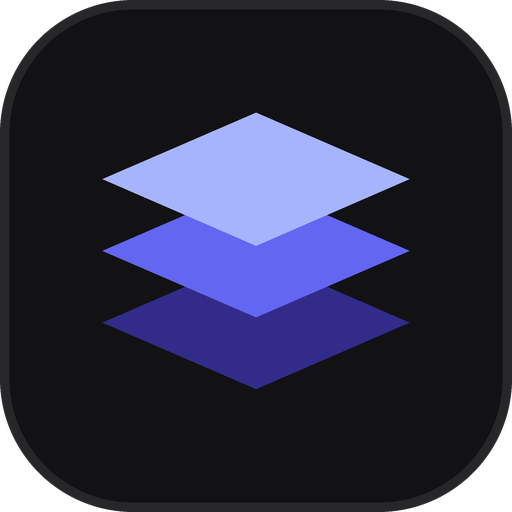

<div align="center">
  
  <h1>DailyStack — Frontend Flutter</h1>
  <p>Application de micro-apprentissage quotidien dédiée au <strong>Backend</strong>, au <strong>DevOps</strong> et à la <strong>veille IA</strong>.</p>
</div>

---

## Fonctionnalités

- **Accueil & Leçon du jour** : tableau de bord quotidien avec série (*streak*), indicateurs de progression, révisions dues et aperçu des actualités tech.
- **Parcours d'apprentissage** : modules filtrables par domaine (*Backend*, *DevOps*) et par niveau (`1` à `5`), lecture continue en Markdown avec sauvegarde et restauration automatique de la position de lecture.
- **Pratique & Révision espacée** : exercices interactifs avec feedback immédiat, niveaux de maîtrise (*Découverte*, *À consolider*, *Maîtrisée*) et suivi des notions.
- **Veille technologique** : actualités classées par catégorie (*Backend*, *DevOps*, *IA*, *Tech Émergente*) et niveau d'importance, recherche par mot-clé, favoris et fiche détaillée.
- **Notifications in-app** : historique des rappels quotidiens avec marquage comme lu et redirection directe vers la leçon concernée.
- **Profil & Accessibilité** : thème clair / sombre / système, échelle typographique personnalisable et préférences de rappels.
- **Mode hors ligne** : mise en cache SQLite locale et file d'attente de synchronisation automatique dès le retour de la connectivité.

---

## Stack technique

- **Framework** : Flutter (Dart SDK `^3.13.7`)
- **Gestion d'état** : [`flutter_riverpod`](https://pub.dev/packages/flutter_riverpod)
- **Navigation** : [`go_router`](https://pub.dev/packages/go_router)
- **Réseau & Sécurité** : [`dio`](https://pub.dev/packages/dio) (intercepteur JWT avec file d'attente de rafraîchissement), [`flutter_secure_storage`](https://pub.dev/packages/flutter_secure_storage)
- **Persistance & Sync hors ligne** : [`sqflite`](https://pub.dev/packages/sqflite), [`connectivity_plus`](https://pub.dev/packages/connectivity_plus)
- **Interface & Contenu** : [`google_fonts`](https://pub.dev/packages/google_fonts) (*Plus Jakarta Sans*), [`flutter_markdown`](https://pub.dev/packages/flutter_markdown)

---

## Architecture du code

```text
dailystack/
├── assets/images/app_logo.png
├── lib/
│   ├── main.dart
│   ├── core/
│   │   ├── config/          # Configuration d'environnement API (ApiConfig)
│   │   ├── network/         # Client Dio, intercepteur JWT & mapping d'erreurs
│   │   ├── providers/       # Providers Riverpod globaux
│   │   ├── router/          # Routes GoRouter & shell de navigation
│   │   ├── storage/         # Base SQLite locale & file de synchronisation
│   │   ├── theme/           # Palette, typographie & thèmes clair/sombre
│   │   └── widgets/         # Composants UI partagés, badges & états
│   └── features/
│       ├── auth/            # Splash, connexion, inscription & profil
│       ├── home/            # Tableau de bord quotidien
│       ├── learning/        # Parcours et détail de leçon
│       ├── notifications/   # Liste et lecture des notifications
│       ├── practice/        # Exercices, révisions et progression
│       ├── sync/            # Gestionnaire de synchronisation hors ligne
│       └── watch/           # Veille technologique et favoris
└── test/                    # Tests unitaires de modèles et tests widgets
```

---

## Lancer le projet

### Prérequis
- [Flutter SDK](https://docs.flutter.dev/get-started/install) configuré sur votre machine
- Un émulateur Android, simulateur iOS, macOS desktop ou un appareil physique connecté

### Installation et démarrage
```bash
cd dailystack
flutter pub get
flutter run
```

Par défaut, l'application pointe vers l'API de production (`https://dailystack-backend.onrender.com/api/v1` — le premier appel peut prendre jusqu'à ~45 s en cas de réveil du serveur).

### Utiliser un backend local
Vous pouvez surcharger l'URL de l'API au lancement via `--dart-define` :

```bash
# macOS / iOS Simulator / Web
flutter run --dart-define=API_BASE_URL=http://localhost:8080/api/v1

# Émulateur Android
flutter run --dart-define=API_BASE_URL=http://10.0.2.2:8080/api/v1
```

---

## Tests et Build

```bash
cd dailystack

# Analyse statique
flutter analyze --no-fatal-infos

# Tests unitaires et widgets
flutter test

# Build APK Android (release)
flutter build apk --release
```

### Signature Android de production
1. Copiez `dailystack/android/key.properties.example` vers `dailystack/android/key.properties`.
2. Générez votre keystore `.jks` et renseignez vos identifiants dans `key.properties` (ce fichier est ignoré par Git).
3. Lancez `flutter build appbundle --release` ou `flutter build apk --release`.

- **Application ID / Bundle Identifier** : `com.dailystack.app`
